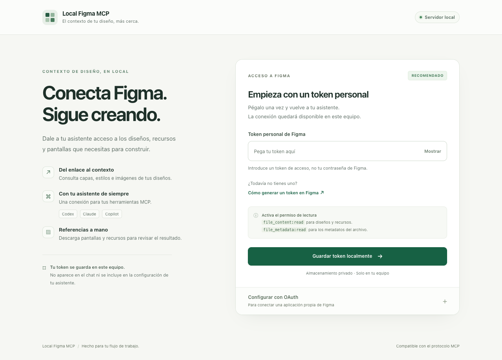

# Local Figma MCP

Servidor MCP local para consultar diseños de Figma desde Codex, Claude y Copilot. Lee propiedades, textos, estilos y componentes, descarga pantallas y recursos, y conserva snapshots consultables sin red. El razonamiento y la implementación quedan a cargo de la IA conectada.

REA se utiliza únicamente como herramienta de investigación durante el desarrollo. No es necesario instalarlo para usar este servidor. Este proyecto implementa una superficie de lectura propia; no afirma reproducir todas las herramientas del MCP oficial ni eliminar permisos o cuotas de la API.



## Instalar y probar

Requisitos: Node.js 22 o superior y acceso al archivo con tu cuenta de Figma.

```sh
git clone https://github.com/manuelcabrera1193/local-figma-mcp.git
cd local-figma-mcp
npm ci
npm run build
npm run install:global
local-figma-mcp login
```

`login` abre un panel en `127.0.0.1`. Si ya tienes un token personal, pégalo en el campo protegido y guárdalo. No necesitas registrar una aplicación OAuth. Permisos iniciales: `file_content:read` y `file_metadata:read`.

También se admite una aplicación OAuth propia desde ese mismo panel. Su callback debe coincidir exactamente con el indicado; la autorización se abre en el navegador del sistema. La API de variables puede requerir un plan y permisos adicionales.

Los secretos se guardan fuera del repositorio, en el directorio de datos del usuario, con permisos privados. No se incluyen en respuestas MCP ni configuraciones de clientes. `FIGMA_TOKEN` y `FIGMA_TOKEN_FILE` permiten una configuración externa opcional; en POSIX, el archivo externo debe ser privado. Nunca pases el token como argumento ni en el chat.

```sh
local-figma-mcp doctor --json
local-figma-mcp setup --client codex,claude-code,claude-desktop,vscode,copilot
local-figma-mcp setup --client codex,claude-code,claude-desktop,vscode,copilot --yes --force
```

`setup` primero muestra un plan. La aplicación requiere `--yes`; los clientes configurados mediante CLI también requieren `--force`, porque su CLI puede reemplazar una entrada del mismo nombre. Se preservan las demás entradas y se crean backups. El identificador instalado es `local-figma`; el ejecutable es `local-figma-mcp`. Reinicia/reconecta el cliente para cargar un servidor nuevo.

## Uso desde una IA

> Usa local-figma para importar este enlace de Figma, consultar el diseño y mostrar la captura descargada.

`figma_import` devuelve un trabajo; consulta `figma_job_status` hasta que termine. Después usa el `snapshotId` para consultar offline. Con `node-id` se importa ese árbol; sin él se importa el archivo. No se inventan estados ni recursos ausentes.

| Herramienta | Resultado |
| --- | --- |
| `figma_connect`, `figma_auth_status`, `figma_disconnect` | Configuración privada y estado de autenticación |
| `figma_status`, `figma_list_snapshots` | Inventario local y procedencia |
| `figma_import`, `figma_job_status` | Importación en segundo plano y progreso |
| `get_metadata`, `get_design_context`, `figma_get_design_context` | Árbol y propiedades de implementación |
| `figma_list_screens`, `get_screenshot`, `figma_get_screenshot` | Pantallas e imagen de referencia |
| `get_variable_defs`, `figma_get_variables` | Estilos/bindings locales y variables accesibles |
| `download_assets`, `figma_get_assets`, `figma_export_assets` | Recursos descargados y exportaciones PNG/SVG |
| `figma_list_flows` | Conexiones de prototipo declaradas; no prueba de ejecución |
| `figma_compare_screen` | Comparación PNG con diff, overlay y reporte HTML |

Los nombres similares al MCP oficial describen equivalencias funcionales de lectura. `get_design_context` devuelve datos del diseño; la IA genera el código. Las consultas paginadas y el contexto limitado indican si hay resultados adicionales o truncamiento.

## Validación web y móvil

`figma_compare_screen` recibe `snapshotId`, `nodeId` y exactamente uno de `actualPath` (ruta absoluta a PNG) o `actualPngBase64`. Puedes usar una captura de navegador, iOS, o el PNG que devuelve `android_screenshot` de `local-android-mcp`/droid. Ambos MCP son independientes; droid conserva su API.

Las imágenes deben tener las mismas dimensiones. El servidor no estira ni recorta silenciosamente. La tolerancia visual inicial es 1 % de píxeles, configurable; el resultado no certifica comportamiento funcional.

## Verificación

Para las pruebas de navegador se usa Chrome si está instalado. En un equipo sin Chrome, instala Chromium para Playwright con `npx playwright install chromium`. Las pruebas usan perfiles temporales y credenciales ficticias.

```sh
npm run check
npm test
npm run test:coverage
npm run smoke
npm run smoke -- --url 'https://www.figma.com/design/ARCHIVO/Nombre?node-id=1-2'
npm audit --audit-level=high
npm pack --dry-run
```

El smoke inicia un cliente MCP real por stdio. Con `--url`, importa desde Figma usando la credencial guardada y consulta contexto, pantallas y recursos. Guarda el resultado seguro en `artifacts/mcp-smoke-result.json`; sin `--url` solo verifica el servidor local. Nunca presenta fixtures como prueba de acceso a Figma.

El directorio de datos predeterminado sigue el sistema operativo y puede configurarse mediante `LOCAL_FIGMA_HOME` absoluto. `logout` elimina las autorizaciones guardadas y conserva los diseños descargados. Las credenciales aportadas por variables de entorno deben quitarse también del entorno para desconectarlas.

El instalador adapta código MIT de `local-android-mcp`; no depende de su carpeta ni modifica ese proyecto.

## Privacidad al contribuir

Los ejemplos y las pruebas usan datos ficticios. No incluyas enlaces de archivos reales, capturas de diseños privados, tokens ni resultados de pruebas contra cuentas reales en commits o issues. Los artefactos locales están excluidos de Git; el paquete también debe revisarse antes de distribuirlo.

Después de preparar los archivos con Git, ejecuta `npm run check:publication` para revisar exactamente lo que se va a publicar. Consulta [SECURITY.md](SECURITY.md) para las pautas de reproducción y reporte.
